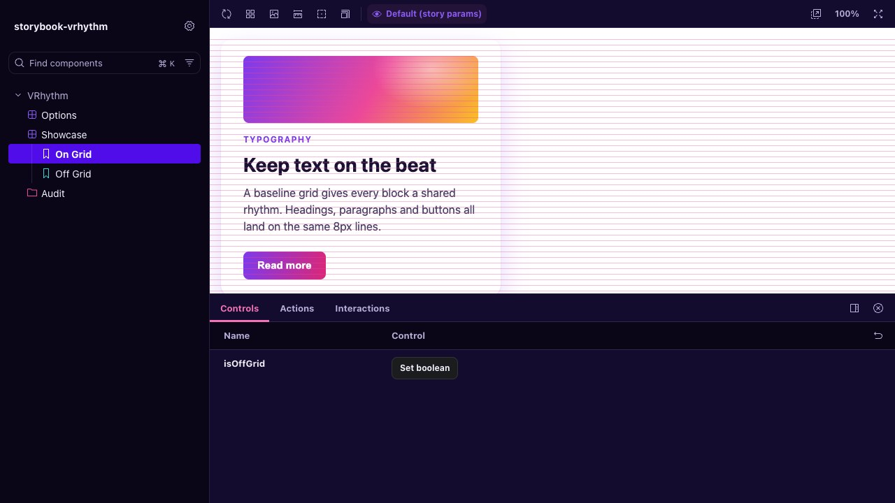

# storybook-vrhythm

[![npm version][npm-badge]][npm]
[![License: MIT][license-badge]][license]
[](https://bundlephobia.com/package/storybook-vrhythm)
[](https://www.npmjs.org/package/storybook-vrhythm)

> Baseline grid overlay for Storybook. See your vertical rhythm while you build.



Stop guessing if your spacing is consistent. `storybook-vrhythm` draws a customizable baseline grid on top of your stories so you can **see** alignment issues as you develop — not after you ship.

## Features

- **Framework agnostic** — React, Vue, Angular, Svelte, Web Components, HTML
- **Toolbar toggle** — Show/hide the grid from Storybook's toolbar, no reload needed
- **Built-in presets** — Material, Tailwind, Bootstrap, and pixel-based grids ready to use
- **Column grids** — Optional vertical column overlay with configurable gutter width
- **Fully customizable** — Color, line height, line width, offset, opacity, z-index, max width
- **Rhythm audit** — Assert grid alignment in `play` functions, with exact pixel offsets in the failure
- **Agent ready** — Ships `llms.txt` and a numeric audit, so coding agents can set it up and fix alignment without screenshots
- **Lightweight** — Pure CSS overlay via `linear-gradient`. Zero runtime dependencies
- **Non-intrusive** — `pointer-events: none` keeps your stories fully interactive
- **TypeScript first** — Full type safety with Storybook parameter augmentation

## Requirements

- Node.js 22.12+
- Storybook 10 or 11

Storybook 10 is supported but not continuously tested: CI runs against Storybook 11 only.

While Storybook 11 is in prerelease, install the `next` tag to use it: `pnpm add -D storybook-vrhythm@next`. The `latest` tag is 0.x, which supports Storybook 10 only.

## Quick start

```bash
pnpm add -D storybook-vrhythm
# or: npm install --save-dev storybook-vrhythm
```

Add to `.storybook/main.ts`:

```typescript
const config = {
  addons: ['storybook-vrhythm'],
};

export default config;
```

Done. A baseline grid overlay is now visible on every story, toggleable from the toolbar.

### CSF Next

Using `definePreview`? Register the addon in `.storybook/preview.ts` instead:

```typescript
import { definePreview } from '@storybook/your-framework';
import vrhythm from 'storybook-vrhythm';

export default definePreview({
  addons: [vrhythm()],
});
```

This gives `parameters.vrhythm` full type safety in your stories. It needs no entry in `.storybook/main.ts`, though keeping one is harmless: the decorator still runs once.

`definePreview` must come from your framework package. `@storybook/html` and `@storybook/html-vite` 11.0.0-beta.0 don't export it, so HTML projects should register the addon in `.storybook/main.ts`.

## Configuration

### Global defaults

Set defaults for all stories in `.storybook/preview.ts`:

```typescript
export const parameters = {
  vrhythm: {
    color: 'rgba(99, 102, 241, 0.2)',
    lineHeight: '8px',
  },
};
```

### Per-story overrides

```typescript
export const Compact = {
  parameters: {
    vrhythm: { lineHeight: '4px', color: 'rgba(244, 67, 54, 0.15)' },
  },
};

export const NoGrid = {
  parameters: {
    vrhythm: { hide: true },
  },
};
```

### Using presets

Skip manual configuration with built-in presets that match popular design systems:

```typescript
export const MaterialGrid = {
  parameters: {
    vrhythm: { preset: 'material' },
  },
};
```

| Preset      | Line height | Color                      | Best for                  |
| ----------- | ----------- | -------------------------- | ------------------------- |
| `4px`       | 4px         | `rgba(0, 150, 255, 0.15)`  | Dense UIs, compact grids  |
| `8px`       | 8px         | `rgba(0, 150, 255, 0.2)`   | Standard 8pt grid systems |
| `12px`      | 12px        | `rgba(0, 150, 255, 0.2)`   | 12px grids, mid-density UIs |
| `16px`      | 16px        | `rgba(204, 204, 204, 0.5)` | Body text baseline        |
| `24px`      | 24px        | `rgba(204, 204, 204, 0.5)` | Heading alignment         |
| `32px`      | 32px        | `rgba(204, 204, 204, 0.5)` | Large-scale layout grids  |

**Aliases.** These names add no style of their own. Each one is exactly the base preset shown, under a name you may recognize from a design system:

| Alias       | Same as | Reason                                    |
| ----------- | ------- | ----------------------------------------- |
| `material`  | `4px`   | Material Design uses a 4dp grid           |
| `tailwind`  | `4px`   | Tailwind's spacing unit is 0.25rem        |
| `bootstrap` | `8px`   | Bootstrap spacing steps are multiples of 8px |
| `carbon`    | `8px`   | IBM Carbon uses an 8px mini-unit          |

### Column grid

Add vertical column lines on top of the horizontal baseline:

```typescript
export const ColumnGrid = {
  parameters: {
    vrhythm: {
      lineHeight: '8px',
      columnWidth: '80px',
      gutterWidth: '16px',
      columnColor: 'rgba(99, 102, 241, 0.1)',
    },
  },
};
```

### Manual decorator

If you prefer to opt out of the addon preset:

```typescript
import { withVRhythm } from 'storybook-vrhythm';

export const decorators = [withVRhythm];
```

## Options

### Style options

| Option        | Type               | Default                | Description                                        |
| ------------- | ------------------ | ---------------------- | -------------------------------------------------- |
| `color`       | `string`           | `'rgb(204, 204, 204)'` | CSS color for horizontal guide lines               |
| `lineHeight`  | `string \| number` | `'16px'`               | Baseline grid height (`'8px'`, `'1rem'`, etc.)     |
| `lineWidth`   | `string \| number` | `'1px'`                | Thickness of each horizontal guide line            |
| `offset`      | `string \| number` | `0`                    | Vertical offset from the top of the container      |
| `opacity`     | `number`           | `1`                    | Overlay opacity (0–1)                              |
| `zIndex`      | `number`           | `9999`                 | Stack order of the overlay                         |
| `maxWidth`    | `string \| number` | —                      | Centers the overlay with this max width            |
| `columnWidth` | `string \| number` | —                      | Repeating column width for a vertical column grid  |
| `columnColor` | `string`           | —                      | CSS color for column lines (falls back to `color`) |
| `gutterWidth` | `string \| number` | —                      | Gutter between columns (requires `columnWidth`)    |

### Config options

| Option      | Type      | Default | Description                                                        |
| ----------- | --------- | ------- | ------------------------------------------------------------------ |
| `hide`      | `boolean` | `false` | Hide the overlay for this story (overrides toolbar toggle)         |
| `preset`    | `string`  | —       | Built-in preset name (see table above)                             |
| `container` | `string`  | —       | CSS selector for the overlay's parent element (defaults to `body`) |

### Parameter resolution order

```text
DEFAULT_PARAMS → preset styles → story-level parameters
```

Later sources override earlier ones. The story-level `hide` param takes precedence over the toolbar toggle.

## Auditing rhythm in tests

The overlay shows the grid to people. `storybook-vrhythm/audit` measures it, so tests, CI and coding agents get numbers instead of a picture. See [Using with coding agents](#using-with-coding-agents) for a ready-made prompt.

```ts
import { expectRhythm } from 'storybook-vrhythm/audit';

export const Card = {
  play: async ({ canvasElement }) => {
    await expectRhythm(canvasElement);
  },
};
```

`expectRhythm` throws when an element is off the grid:

```text
Expected elements on the 8px grid starting at y=0px, found 1 off-grid:
  h2.title top: 21px, nearest 24px (delta -3px)
```

Use `auditRhythm` to get the result as data:

```ts
import { auditRhythm } from 'storybook-vrhythm/audit';

const report = await auditRhythm(canvasElement);
// {
//   ok: false,
//   grid: { lineHeight: 8, origin: 0 },
//   checked: 12,
//   violations: [
//     { selector: 'h2.title', edge: 'top', actual: 21, nearest: 24, delta: -3 },
//   ],
// }
```

`grid.origin` is the viewport Y of the first grid line. `actual` and `nearest` are relative to it. It comes from the overlay's top, or from the top of `root` plus `offset` when `offset` is set or the overlay is hidden.

Options for both functions:

| Option       | Type                      | Default          | Description                                                            |
| ------------ | ------------------------- | ---------------- | ---------------------------------------------------------------------- |
| `lineHeight` | `string \| number`        | From the overlay | Grid size in `px`, `rem`, or a number of pixels                        |
| `offset`     | `string \| number`        | Overlay position | Grid start below the top of `root`, unlike the story's `offset`        |
| `tolerance`  | `number`                  | `0.5`            | Allowed distance from a grid line, in pixels                           |
| `checks`     | `('box' \| 'baseline')[]` | `['box']`        | What to measure                                                        |
| `ignore`     | `string`                  | —                | Selector to skip, on top of `[data-vrhythm-ignore]`                    |

- **`box`** checks the top and bottom of each visible element, except the `root` itself, inline text elements and inline `svg`. It suits spacing grids such as 4px and 8px.
- **`baseline`** checks each line of text. It suits type-driven grids. Don't use it on a spacing grid: 16px text in a 24px line sits about 17px below an on-grid box. Results can differ by up to 1px, and more with `font-stretch` or `font-size-adjust`, so raise `tolerance` if needed.
- **Invalid setups throw:** `RhythmConfigError` means the audit could not give a real answer. It covers a `lineHeight` or `offset` that is not a finite `px` or `rem` length, a `lineHeight` of 0 or less, a `tolerance` that is negative, not finite, or half of `lineHeight` or more (no layout could fail it), and an edge or baseline the environment cannot measure.
- **Fixing violations:** work from the top down and rerun after each change. Moving an edge shifts everything below it, so `delta` values further down go stale, and on-grid edges can move off.
- **Off-grid on purpose?** Add `data-vrhythm-ignore` to skip an element and everything inside it. Use it when the component owns the decision. Use the `ignore` option, which also skips subtrees, to exclude something for one story or without touching markup.
- **Real layout required:** run it in a browser, such as `@storybook/addon-vitest` with Playwright. jsdom has no layout, so `expectRhythm` fails there with `Nothing was measured`.
- **Hidden overlay:** with `hide: true` or the toolbar set to Hide, pass `lineHeight` yourself. The origin is then the top of `root`, not the top of the page.
- **Default Storybook layout:** the `padded` layout adds 1rem of body padding, which is off a 24px grid. Use `layout: 'fullscreen'` for those stories.

## Using with coding agents

Coding agents such as Claude Code, Cursor and Copilot can set up the addon and fix alignment on their own. Two things make that work:

- **`llms.txt`** ships in the package at `node_modules/storybook-vrhythm/llms.txt`. It holds the API, the options and the fix workflow in a form agents read well. It is also on [GitHub](https://github.com/jmlweb/storybook-vrhythm/blob/main/packages/storybook-vrhythm/llms.txt).
- **`storybook-vrhythm/audit`** returns numbers, not pixels. An agent can't judge a screenshot of a grid overlay, but it can move an edge by `-delta` pixels and rerun the test.

Copy this prompt into your agent and replace the parts in `<...>`:

```text
Put <Component> on a <8px> baseline grid with storybook-vrhythm.

1. Read node_modules/storybook-vrhythm/llms.txt first. If the package is not installed, add it as a dev dependency and register it in .storybook/main.ts, or in .storybook/preview.ts with definePreview if this project uses CSF Next.
2. Set lineHeight to <8px> in parameters.vrhythm, globally in .storybook/preview.ts or in the story.
3. Add `await expectRhythm(canvasElement)` from 'storybook-vrhythm/audit' to the play function of <path/to/Component.stories.tsx>.
4. Run that story's tests with this project's Storybook test command. It must run in a real browser (Vitest + Playwright), not jsdom.
5. Fix violations from the top down: move each reported edge by -delta pixels, rerun after every change, and repeat until the audit passes.
6. Add data-vrhythm-ignore only to elements that are off-grid on purpose, and say why. Do not raise tolerance, lower lineHeight or delete the assertion to make the test pass.

Report what you changed and the final audit result.
```

## Why vertical rhythm?

Vertical rhythm is the practice of aligning elements to a consistent baseline grid. When text, images, and components share the same vertical cadence, layouts feel cohesive and polished — even if users can't articulate why.

This addon makes the invisible grid visible during development, so spacing inconsistencies get caught in Storybook instead of production.

## Contributing

Contributions are welcome. See [CONTRIBUTING.md](https://github.com/jmlweb/storybook-vrhythm/blob/main/CONTRIBUTING.md) for the setup, or open an [issue](https://github.com/jmlweb/storybook-vrhythm/issues).

## Inspiration

[Baseliner](https://jpedroribeiro.com/2015/08/baseliner-my-first-chrome-extension/) — a Chrome extension by JP Ribeiro for overlaying baseline grids.

## License

[MIT](https://github.com/jmlweb/storybook-vrhythm/blob/main/LICENSE)

[npm-badge]: https://img.shields.io/npm/v/storybook-vrhythm.svg
[npm]: https://www.npmjs.org/package/storybook-vrhythm
[license-badge]: https://img.shields.io/badge/license-MIT-blue.svg
[license]: https://github.com/jmlweb/storybook-vrhythm/blob/main/LICENSE
