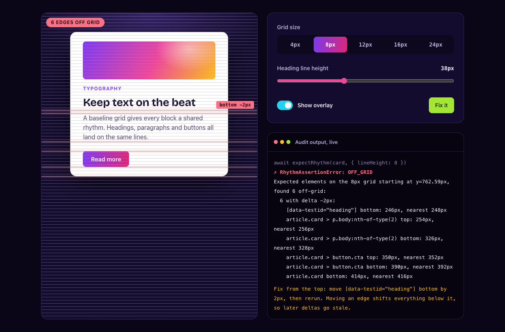

<div align="center">

<a href="https://jmlweb.github.io/storybook-vrhythm/"></a>

# storybook-vrhythm

[![npm version][npm-badge]][npm]
[![License: MIT][license-badge]][license]
[![Bundle Size][size-badge]][size]
[![Zero Dependencies][deps-badge]][npm]

**[Live demo](https://jmlweb.github.io/storybook-vrhythm/)** · [Storybook](https://jmlweb.github.io/storybook-vrhythm/storybook/) · [Reference](https://github.com/jmlweb/storybook-vrhythm/blob/main/packages/storybook-vrhythm/docs/reference.md) · [`llms.txt`](https://github.com/jmlweb/storybook-vrhythm/blob/main/packages/storybook-vrhythm/llms.txt)

</div>

Measures your stories against a baseline grid and draws that grid on top of them. Agents and tests get exact pixel offsets. You get a visible grid.

<a href="https://jmlweb.github.io/storybook-vrhythm/"></a>

<p align="center"><sub>The <a href="https://jmlweb.github.io/storybook-vrhythm/">live playground</a> runs the real audit in your browser. Break the rhythm, read the fix.</sub></p>

## Quick start

Requires Node.js 22.12+ and Storybook 10 or 11. CI runs unit and browser tests against both.

```bash
npx storybook add storybook-vrhythm@next
```

> **Install the `next` tag on Storybook 10 or 11.** The `latest` tag is 0.x: it supports Storybook 10 only and has no audit, so `storybook-vrhythm/audit` will not resolve. `next` moves to `latest` as `1.0.0` when Storybook 11 is released.

That installs and registers the addon. A baseline grid now shows on every story, toggleable from the toolbar.


Using `definePreview` (CSF Next)? Register it in `.storybook/preview.ts`. This also types `parameters.vrhythm` in your stories:

```typescript
import { definePreview } from '@storybook/your-framework';
import vrhythm from 'storybook-vrhythm';

export default definePreview({
  addons: [vrhythm()],
});
```

Otherwise, run `pnpm add -D storybook-vrhythm@next` and add `'storybook-vrhythm'` to `addons` in `.storybook/main.ts`. HTML projects need this path: `@storybook/html` 11.0.0-beta.0 does not export `definePreview`.

## Use it with a coding agent

Coding agents can't judge a screenshot of a grid. `storybook-vrhythm` gives them numbers: each off-grid edge, how far off it is, and which way to move it.

### Set up in one prompt

Copy this into your agent:

```text
Put <Component> on a <8px> baseline grid with storybook-vrhythm.

1. Read https://raw.githubusercontent.com/jmlweb/storybook-vrhythm/main/packages/storybook-vrhythm/llms.txt, or node_modules/storybook-vrhythm/llms.txt if it is installed.
2. Install it with `npx storybook add storybook-vrhythm@next` and set `vrhythm: { lineHeight: '<8px>', audit: 'error' }` in the story's parameters.
3. Run that story's tests in a real browser.
4. Fix violations from the top: move each reported edge by -delta pixels, rerun after every change, and repeat until it passes.
5. Add data-vrhythm-ignore only to elements that are off-grid on purpose, and say why. Do not raise tolerance, lower lineHeight or remove the audit to get a pass.

Report what you changed and the final result.
```

### Or give the agent a skill

The package ships an [Agent Skill](https://github.com/jmlweb/storybook-vrhythm/tree/main/packages/storybook-vrhythm/skills/storybook-vrhythm) at `node_modules/storybook-vrhythm/skills/`, covering setup, the fix loop, error codes and the rules against silencing the audit. Copy it to your agent's skills folder.

### Turn on the audit by hand

After the [quick start](#quick-start), add story tests if you have none:

```bash
npx storybook add @storybook/addon-vitest
```

The `audit` parameter needs `1.0.0-next.3` or later. Older versions ignore it, so nothing fails.

Audit every story from `.storybook/preview.ts`, with no `play` functions to write:

```typescript
const preview = {
  parameters: {
    vrhythm: { lineHeight: '8px', audit: 'error' },
  },
};

export default preview;
```

An off-grid story now fails, and the failure tells the agent what to do:

```text
Expected elements on the 8px grid starting at y=0px, found 1 off-grid:
  button.storybook-button bottom: 36px, nearest 40px (delta -4px)
Fix from the top: move button.storybook-button bottom by 4px, then rerun. Moving an edge shifts everything below it, so later deltas go stale.
```

### Run it through MCP

With [`@storybook/addon-mcp`](https://github.com/storybookjs/mcp), an agent can run tests without a shell:

```bash
npx storybook add @storybook/addon-mcp
```

Connect the agent to `http://localhost:6006/mcp` and have it call the `test-run` tool. Failures with `audit: 'error'` appear under `Failing Stories`, with the same text as above.

### Adopt it gradually

Tighten in steps, per component if you like:

| Step | Setting                                                   | Effect                                                 |
| ---- | --------------------------------------------------------- | ------------------------------------------------------ |
| 1    | `audit: 'todo'`                                           | Warns in the console, fails nothing                    |
| 2    | `audit: 'error'`, `auditOptions: { edges: ['top'] }`      | Holds new work to the grid on top edges. Misses a wrong height |
| 3    | `audit: 'error'`                                          | Full check                                             |


## Features

- 🤖 **Built for coding agents:** one parameter audits every story, and failures name the edge, delta and fix, through Vitest or MCP
- 🧪 **Rhythm audit:** assert alignment in `play` functions, with exact pixel offsets on failure
- 🎯 **Same result everywhere:** the grid starts at the story root, so `centered`, `padded` and `fullscreen` agree at any viewport height
- 📦 **Agent skill and `llms.txt`:** ship with the package
- 🧩 **Framework agnostic:** React, Vue, Angular, Svelte, Web Components, HTML
- 🎛️ **Toolbar toggle:** show, hide or switch grids without a reload
- 📐 **Presets:** pixel grids from 4px to 32px, plus Material, Tailwind, Bootstrap and Carbon aliases
- 🏛️ **Column grids:** optional vertical columns with gutters
- 🎨 **Customizable:** color, line height, line width, offset, opacity, z-index, max width
- 🪶 **Lightweight:** pure CSS `linear-gradient`, zero runtime dependencies
- 🖱️ **Non-intrusive:** `pointer-events: none` keeps stories interactive
- 🔒 **Typed:** typed parameters under CSF Next, editor completion for presets


## Documentation

- [Reference](https://github.com/jmlweb/storybook-vrhythm/blob/main/packages/storybook-vrhythm/docs/reference.md): configuration, presets, grid origin, column grids, every option, the audit API and error codes
- [`llms.txt`](https://github.com/jmlweb/storybook-vrhythm/blob/main/packages/storybook-vrhythm/llms.txt): the same in one file for agents, also at `node_modules/storybook-vrhythm/llms.txt`
- [Agent Skill](https://github.com/jmlweb/storybook-vrhythm/tree/main/packages/storybook-vrhythm/skills/storybook-vrhythm): setup, the fix loop and the rules against silencing the audit

## Contributing

See [CONTRIBUTING.md](https://github.com/jmlweb/storybook-vrhythm/blob/main/CONTRIBUTING.md) or open an [issue](https://github.com/jmlweb/storybook-vrhythm/issues).

## Credits

Inspired by [Baseliner](https://jpedroribeiro.com/2015/08/baseliner-my-first-chrome-extension/), a Chrome extension by JP Ribeiro.

## License

[MIT](https://github.com/jmlweb/storybook-vrhythm/blob/main/LICENSE)

[npm-badge]: https://img.shields.io/npm/v/storybook-vrhythm.svg?style=for-the-badge&labelColor=140c2e&color=8b5cf6
[npm]: https://www.npmjs.org/package/storybook-vrhythm
[license-badge]: https://img.shields.io/badge/license-MIT-ec4899.svg?style=for-the-badge&labelColor=140c2e
[license]: https://github.com/jmlweb/storybook-vrhythm/blob/main/LICENSE
[size-badge]: https://img.shields.io/bundlephobia/minzip/storybook-vrhythm?style=for-the-badge&labelColor=140c2e&color=f59e0b
[size]: https://bundlephobia.com/package/storybook-vrhythm
[deps-badge]: https://img.shields.io/badge/dependencies-0-22d3ee?style=for-the-badge&labelColor=140c2e
